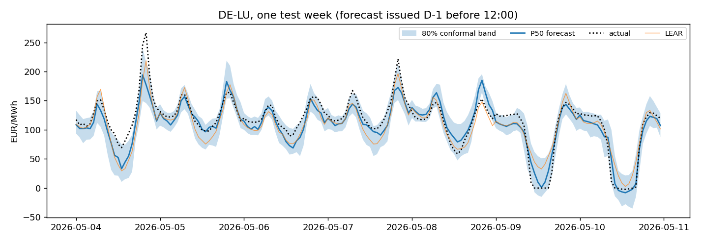
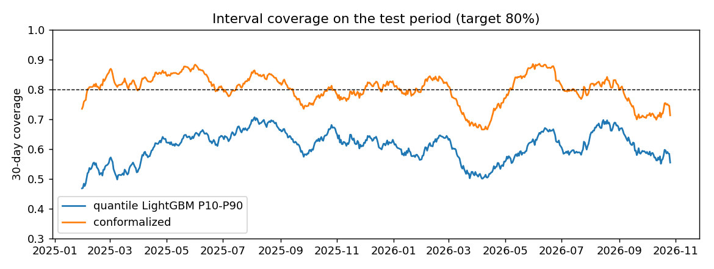
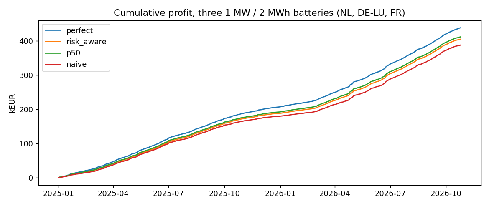
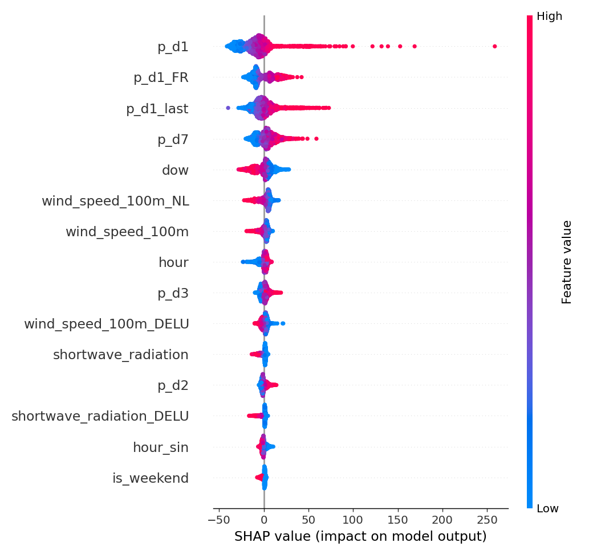

# powercast

**Day-ahead electricity price forecasts for NL, DE-LU and FR with calibrated uncertainty, and proof that they are worth money.**

> On 663 out-of-sample days (Jan 2025 to Oct 2026), quantile LightGBM reaches **rMAE 0.571** vs the naive benchmark and **beats the LEAR benchmark by 5.5% MAE** (Diebold-Mariano p < 0.001 for NL and DE-LU, p = 0.02 for FR). Conformal calibration brings the 80% interval coverage from 60% to **79.8%**, and a battery trading on the median forecast captures **93.9% of perfect-foresight profit** vs 88.5% on the naive forecast.



## Results (test period 2025-01-01 to 2026-10-25, walk-forward)

**Point accuracy** (EUR/MWh, all three zones pooled; per-zone tables in [reports/tables/point.csv](reports/tables/point.csv))

| Model | MAE | RMSE | rMAE |
|---|---:|---:|---:|
| Naive (EPF standard: D-7 Mon/Sat/Sun, D-1 otherwise) | 28.82 | 44.99 | 1.000 |
| Naive, same hour yesterday | 26.48 | 41.46 | 0.919 |
| LEAR (LASSO-estimated autoregressive, 1y + 3y ensemble) | 17.41 | 26.71 | 0.604 |
| **LightGBM (global, tuned on 2024 only)** | **16.46** | **26.00** | **0.571** |

| Zone | LEAR MAE | LightGBM MAE | DM statistic | p-value (LGBM better) |
|---|---:|---:|---:|---:|
| NL | 17.09 | 16.02 | 3.59 | < 0.001 |
| DE-LU | 16.96 | 15.87 | 3.51 | < 0.001 |
| FR | 18.19 | 17.49 | 2.05 | 0.020 |

**Probabilistic accuracy** (target coverage 80%)

| Interval | Coverage | Mean width (EUR/MWh) |
|---|---:|---:|
| Quantile LightGBM P10-P90 | 60.4% | 35.3 |
| + online conformal calibration (CQR, 90-day window) | **79.8%** | 50.8 |



**Battery trading backtest** (1 MW / 2 MWh, 90% round-trip efficiency, at most one cycle per day, schedule optimised as a daily LP and settled at actual prices; one battery per zone)

| Strategy | Profit (EUR) | % of perfect foresight | Worst day (EUR) |
|---|---:|---:|---:|
| Perfect foresight (upper bound) | 438,741 | 100.0 | +9 |
| Naive forecast | 388,093 | 88.5 | -107 |
| **P50 forecast** | **412,046** | **93.9** | -29 |
| Risk-aware (buy at P90, sell at P10) | 405,272 | 92.4 | **-7** |

The forecast earns about EUR 24k more than the naive one over the period. The risk-aware strategy gives up 1.5 points of capture to cut the worst day from -29 to -7 EUR. Sensitivity to efficiency (80-100%) and duration (1-4 h) is in [reports/tables/trading_sensitivity.csv](reports/tables/trading_sensitivity.csv). Capture rises with duration (92.8% at 1 h, 95.2% at 4 h).



## Where the model loses

Averages hide the hard hours, so errors are split by regime ([reports/tables/regimes.csv](reports/tables/regimes.csv)):

| DE-LU regime | Hours | MAE naive | MAE LEAR | MAE LightGBM |
|---|---:|---:|---:|---:|
| All hours | 15,912 | 30.8 | 17.0 | 15.9 |
| Spike hours (top 5%) | 796 | 67.3 | 49.1 | 45.2 |
| Negative prices | 1,050 | 39.1 | 30.8 | 23.2 |
| Holidays | 384 | 40.8 | 34.1 | 23.1 |

Spike hours still have about 3x the average error. **2022 crisis stress test** ([reports/tables/stress_2022.csv](reports/tables/stress_2022.csv)): trained on 2019-2021 only and retrained monthly through 2022, the model beats naive in most months but **loses in July-August 2022** (rMAE 1.0-1.5), when gas prices tripled. It has no fuel-price input, and raw interval coverage falls to 28-46%. Adding TTF gas and EUA carbon prices is the clear next step.

## Leakage-safe setup

The day-ahead auction for day D closes at **12:00 CET on D-1**. Every feature is something you know at that moment:

* price lags start at D-1 (D-1, D-2, D-3, D-7, D-1 min/max/mean/std, D-1 last hour, and the other two zones' D-1 prices);
* weather for day D comes from **archived forecasts** (Open-Meteo Historical Forecast API), never observed weather;
* calendar: hour, weekday, holidays per country, DST transition days.

Time handling: data is stored in UTC and converted to market time only to build the day x 24 h layout. On the 23-hour day the missing hour is filled from the previous one, and on the 25-hour day the repeated hour is averaged. 15-minute prices (from Oct 2025) are averaged to hourly. Splits are strictly chronological: train 2019-2023, tune on 2024, test 2025 onward. Walk-forward retraining happens every 28 days, LEAR recalibrates every 7 days, and the conformal correction for day D uses only days already settled. [tests/test_features.py](tests/test_features.py) checks that perturbing day D's prices changes no feature of day D.

## Explainability



Yesterday's prices (own zone and France) dominate. Next come weekday, Dutch and German wind (more wind, lower price) and solar radiation. Each pushes the price the way the physics says it should.

## Architecture

```
Energy-Charts prices ─┐                                    ┌─ FastAPI /forecast (Docker)
Open-Meteo forecasts ─┼─ raw parquet ─ silver (UTC, hourly, ─ gold features ─ LightGBM P10/P50/P90 ─ conformal ─┼─ Streamlit dashboard
ENTSO-E (optional)  ──┘                gaps flagged)          (as of D-1 12:00)   LEAR benchmark                 └─ battery LP backtest
                         GitHub Actions: daily 08:30 UTC ingest -> features -> next-day forecast -> commit
```

```
src/powercast/
  ingest/      price_client.py, weather_client.py, entsoe_client.py
  transform/   silver.py, features.py
  models/      baselines.py, lear.py, lgbm.py, conformal.py
  evaluate/    metrics.py, dm_test.py
  trading/     battery_lp.py, strategies.py
  api/         main.py
  pipeline.py  stages: ingest features tune backtest evaluate trade stress forecast
app/streamlit_app.py     forecast fan chart, backtest, trading, drift monitor
notebooks/               01_eda.py, 05_results_figures.py (py:percent, open in VS Code/Jupyter)
tests/                   leakage, DST, LP physics, API
```

## Run it

```bash
pip install -e ".[dev]"
python -m powercast.pipeline all          # ~1.5 h on a laptop: backfill, tune, backtest, evaluate, trade, stress, forecast
python -m powercast.pipeline daily        # refresh data and forecast the next delivery day
streamlit run app/streamlit_app.py
uvicorn powercast.api.main:app            # GET /forecast?zone=NL  or  /forecast?zone=FR&date=2026-06-15
pytest
```

Docker: `docker build -t powercast . && docker run -p 8000:8000 powercast`.

## Data sources

* **Day-ahead prices**: [Energy-Charts API](https://api.energy-charts.info) (Fraunhofer ISE; Bundesnetzagentur / SMARD.de, CC BY 4.0), which republishes the EPEX/ENTSO-E auction results.
* **Weather forecasts**: [Open-Meteo Historical Forecast API](https://open-meteo.com/en/docs/historical-forecast-api) for 13 points across the three zones, plus the live forecast API for tomorrow.
* **Load, wind and solar forecasts (optional)**: ENTSO-E Transparency Platform. Set `ENTSOE_API_KEY` and the pipeline adds `load_fc`, `wind_fc`, `solar_fc` and `residual_load_fc` automatically.

## Limitations and next steps

* No TSO load or renewable forecasts yet (waiting for the ENTSO-E token). Residual load is usually the strongest single driver, so this should improve accuracy most.
* The archived weather forecasts are stitched from recent model runs, so their lead time is somewhat shorter than a real D-1 12:00 forecast. This slightly flatters the weather features.
* No fuel or carbon prices: the 2022 stress test shows that is the main weakness in a gas-driven regime.
* The battery is a price-taker with no degradation cost, fees or bid curves, so profits are an upper estimate for a small asset.
* Stretch: N-HiTS via `neuralforecast`, MLflow tracking, Optuna for a wider search.
